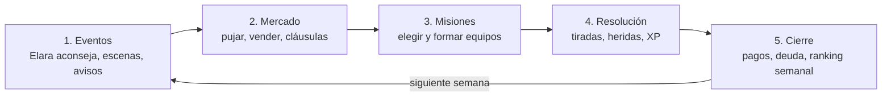

# Gremio Rango D — Documento de Diseño

Versión 1.1 · 6 de noviembre de 2026 · Este archivo es la versión de referencia

## 1. Visión y pitch

**Pitch:** El sistema te dio un rango D. Tú tienes poder de dios. Tu gremio tiene una sola maga y deudas. Ficha, vende y manda héroes a misiones hasta que el peor gremio del mundo sea el primero.

Es un juego de gestión de gremio por temporadas: pujas por héroes contra 4 gremios rivales, formas equipos, los envías a misiones con riesgo de muerte permanente y equilibras dinero, prestigio y reputación.

**Pilares de diseño**

1. **Gestión con riesgo real.** Cada misión es una apuesta: oro y prestigio contra la posibilidad de perder a un héroe para siempre.
2. **Los vínculos importan.** Familia, amistad y romance cambian a quién puedes fichar, cómo rinde un equipo y cuánto duele una pérdida.
3. **La revancha del desvalido.** Empiezas en el fondo de la tabla; cada fichaje arrebatado a un rival es una pequeña victoria narrativa.
4. **Poder oculto que se revela.** El protagonista desbloquea su poder por hitos, y cada despertar cambia las reglas del juego.

**Público:** jugadores de juegos de gestión deportiva y de fantasía anime; partidas de 20–40 min por temporada.

**Referencias de género:** gestión de club deportivo (fichajes, plantilla, ranking), gestión de mercenarios con muerte permanente, novela ligera isekai de gremios.

## 2. Narrativa

La historia es la de una promesa: llevar al gremio Llama Menguante del 5.º puesto al 1.º en un máximo de 5 temporadas.

### Prólogo (jugable, ~5 min)

1. **La invocación.** El protagonista (nombre y aspecto elegibles) despierta en el Círculo de Invocación de la ciudad de Aster, junto a otros 40 candidatos de otros mundos.
2. **La Prueba del Despertar.** Cada candidato toca el Cristal de Resonancia. El jugador ve a otros obtener B, A y un S que provoca aplausos.
3. **El error.** Al tocarlo el jugador, el cristal se queda en blanco, parpadea y muestra "D". Una grieta diminuta aparece en su base; solo la maestra la ve.
4. **El Draft.** Los 4 grandes gremios pujan en público por los candidatos fuertes. Nadie puja por el jugador. Las risas son parte de la escena.
5. **La maestra.** Elara Nocturne, líder del gremio Llama Menguante, hace la única oferta del día: 1 moneda de oro simbólica. Explica que los otros gremios bloquearon todos sus fichajes durante 3 años.
6. **La Promesa.** En la sede vacía y llena de deudas, el jugador promete: "Tomaré las riendas. Ficharemos a los mejores. Seremos el gremio número uno." Elara le nombra Maestro de Gremio en funciones. Empieza el juego.

### Arcos por temporada

| Temporada | Arco | Objetivo narrativo | Despertar del protagonista |
| --- | --- | --- | --- |
| 1 | Sobrevivir | Pagar la primera cuota de la deuda y evitar el cierre | Despertar I: Ojo del Origen (ve el potencial oculto de los héroes) |
| 2 | Ser tomados en serio | Subir al 4.º puesto y ganar el primer Draft disputado | Despertar II: Bendición (aura que reduce la mortalidad del equipo) |
| 3 | La conspiración | Descubrir quién saboteó a Elara y por qué | Despertar III: Mano del Creador (sube el rango de un héroe por temporada) |
| 4 | Guerra de gremios | Ganar el Torneo de Gremios contra el 1.º | Despertar IV: Juicio (el protagonista puede ir a misiones S) |
| 5 | La cima | Ser 1.º al cierre de temporada | Despertar V: Revelación del rango real, "EX" |

**Final:** al llegar al 1.º puesto, el Cristal de Resonancia se vuelve a usar en público y estalla. El sistema crea el rango EX. Si el jugador no alcanza el 1.º al final de la temporada 5, hay un final alternativo agridulce y modo libre.

## 3. Mundo y los 5 gremios

El juego transcurre en Aster, ciudad-estado donde 5 gremios con licencia compiten por misiones, héroes y el favor de la Asociación de Gremios.

- **La Asociación de Gremios:** organismo neutral (en teoría). Publica el ranking, reparte el tablón de misiones y organiza el Draft anual. Un gremio que no paga su cuota de licencia 2 semanas seguidas pierde la licencia.
- **El Draft anual:** semana 1 de cada temporada. Llegan 12–20 candidatos invocados con su rango ya medido.
- **El mercado abierto:** durante la temporada, héroes libres, héroes en venta y aventureros locales.

| Gremio | Especialidad | Líder | Estilo de puja | Actitud inicial hacia el jugador |
| --- | --- | --- | --- | --- |
| Corona de Acero (1.º) | Guerreros y tanques | Duque Valdric Holm, orgulloso, aristocrático | Paga mucho por rangos S y A; ignora el potencial | Desprecio |
| Orden del Alba Dorada (2.º) | Sanadores y paladines | Suma Sacerdotisa Seraphine, educada y calculadora | Puja por reputación; rechaza héroes con mala fama | Condescendencia; posible aliada en la temporada 3 |
| Colmillo Carmesí (3.º) | Asesinos y exploradores | Rhaz "el Lobo", agresivo y tramposo | Pujas sorpresa en la última ronda; sabotea | Hostil; principal saboteador |
| Tejedores del Velo (4.º) | Magos y hechiceros | Archimago Orrin Thale, antiguo maestro de Elara | Busca potencial alto y rarezas elementales | Rivalidad personal con Elara; villano oculto del arco 3 |
| Llama Menguante (5.º) | Sin especialidad: acepta héroes de todas las clases y razas | Elara Nocturne, maga S de fuego y luz | — | El gremio del jugador |

**Elementos:** Fuego, Agua, Tierra, Viento, Luz, Sombra. Cada uno vence a otro en el ciclo Fuego > Viento > Tierra > Agua > Fuego; Luz y Sombra se vencen mutuamente.

## 4. Personajes clave

El protagonista es el gestor, no una unidad más: su poder actúa como un árbol de habilidades de gremio que se desbloquea por hitos.

### El protagonista

- **Rol:** Maestro de Gremio. Toma todas las decisiones de mercado y misiones. El jugador elige su nombre y su aspecto.
- **Rango oficial:** D (visible para todos los PNJ y gremios hasta el final).
- **Poder real:** "Resonancia Primordial". Se desbloquea en 5 Despertares (tabla de la sección 2). Cada uno se activa al cumplir un hito: I, completar 5 misiones con éxito en la temporada 1; II, terminar una temporada en el 4.º puesto o mejor; III, resolver el arco 3; IV, llegar al 2.º puesto; V, terminar 1.º.
- **Riesgo narrativo:** si algún rival descubre su poder antes de tiempo, la Asociación abre una investigación (evento de la temporada 3). Usar el Despertar IV en misiones S sube la "Sospecha" (0–100); al llegar a 100 se dispara ese evento antes de tiempo.

### Elara Nocturne, la maestra

- **Rango:** S. Fuego y Luz. Clase: Hechicera de batalla.
- **Stats:** Poder 75 · Defensa 72 · Magia 99 · Agilidad 88 (suma de combate 334) · Moral 40 al inicio.
- **Rol jugable:** puede ir a misiones, pero está vetada para las de rango S por una sanción de la Asociación (se levanta en el arco 3). Es la consejera: comenta cada puja ("Ese chico tiene una hermana en el Alba Dorada...").
- **Afinidad con el protagonista (0–100):** sube al cumplir promesas, bajar deuda y proteger a héroes. Con 80 o más se desbloquea su historia completa y una escena final de romance sugerido.
- **Si muere:** no puede morir (protagonista de historia); con heridas graves queda fuera 4 semanas.

### Rivales con nombre

- **Duque Valdric Holm** (Corona de Acero): el muro que hay que superar. Ofrece comprar al jugador una vez por temporada.
- **Rhaz "el Lobo"** (Colmillo Carmesí): sabotajes, rumores, robo de misiones.
- **Orrin Thale** (Tejedores del Velo): manipuló el Cristal de Resonancia para hundir a Elara. Villano del arco 3.
- **Seraphine** (Alba Dorada): neutral; si la reputación del jugador supera 70, se convierte en aliada y ofrece cesiones.

## 5. Héroes

Cada héroe es una carta con rango, clase, raza, elemento, 5 stats, 1–3 rasgos, potencial y vínculos con otros héroes.

### Rangos

| Rango | Suma de combate (Poder + Defensa + Magia + Agilidad) | Potencial máx. | Salario semanal (oro) | Valor de mercado (oro) | Frecuencia en el Draft |
| --- | --- | --- | --- | --- | --- |
| S | 330–400 | S | 400–600 | 15.000–30.000 | 1 por Draft |
| A | 260–329 | S | 200–350 | 6.000–14.000 | 2–3 |
| B | 200–259 | A | 100–180 | 2.500–5.500 | 4–5 |
| C | 150–199 | B | 50–90 | 800–2.200 | 4–5 |
| D | 100–149 | B | 20–45 | 200–700 | 2–4 |
| F | 50–99 | C | 10–15 | 50–150 | Solo mercado abierto |

El **potencial oculto** puede superar el máximo de la tabla. Solo se ve con el Despertar I: así el jugador encuentra "joyas" de rango D con potencial S que los rivales ignoran.

### Stats (0–100 cada uno)

- **Poder:** daño físico. **Defensa:** reduce heridas y muertes. **Magia:** daño y curación mágicos. **Agilidad:** exploración, huida, iniciativa. **Moral:** multiplicador de rendimiento (0,7× con Moral 0; 1,15× con Moral 100).

### Clases

| Clase | Stat principal | Posición natural | Función en misión |
| --- | --- | --- | --- |
| Tanque | Defensa | Vanguardia | Absorbe el riesgo de muerte del equipo (−30% para el resto) |
| Guerrero | Poder | Vanguardia | Daño constante |
| Mago | Magia | Retaguardia | Mucho daño; frágil |
| Sanador | Magia | Retaguardia | Convierte muertes en heridas graves (1 vez por misión) |
| Explorador | Agilidad | Centro | Revela el riesgo real de la misión; mejora la huida |
| Soporte | Moral | Centro | +10% al éxito del equipo; sube la Moral tras la misión |

**Razas:** humano, elfo, enano, bestiahombre, dracónido y demonio menor. Cualquier raza puede tener cualquier clase. En el prototipo la raza es estética y solo afecta a los vínculos de Familia, que se dan dentro de la misma raza.

### Rasgos (ejemplos)

- **Codicioso:** +20% al peso del dinero en sus decisiones; −10 Moral si su salario baja.
- **Leal:** no acepta ofertas de venta si su Moral es mayor que 60; +15% a su aportación si va en equipo con un vínculo positivo.
- **Temerario:** +10% a su aportación al poder del equipo, +5 puntos de riesgo de muerte.
- **Cobarde:** huye antes; nunca muere en misiones de su rango o inferiores.
- **Ambicioso:** solo ficha por gremios del Top 3, salvo que el prestigio del jugador supere 60.
- **Romántico:** su vínculo de romance cuenta doble.
- **Veterano:** +1 rango efectivo en misiones; se retira antes (edad +5 años).

### Edad y progresión

- Edad 16–45. Crece con XP de misiones hasta los 28; estable de 29 a 35; pierde un 3% de stats por temporada desde los 36.
- Sube de rango al alcanzar la suma de stats del rango siguiente, sin superar su potencial.

### Vínculos

Cada héroe puede tener 0–3 vínculos con otros héroes del mundo (en cualquier gremio o libres): **Familia**, **Amistad**, **Romance** o **Rivalidad**. Afectan a fichajes (sección 7), misiones (sección 9) y moral (sección 12).

## 6. Bucle de juego

Cada semana el jugador recorre 5 fases y pulsa "Terminar semana"; una temporada dura 20 semanas.



Una temporada = 20 semanas: **semana 1** Draft anual de invocados · **semanas 2 a 19** bucle semanal y mercado abierto · **semana 20** premios y ranking final.

Las misiones de 2–4 semanas mantienen a sus héroes fuera y se resuelven en la fase 4 de la semana en que terminan. Al pulsar "Terminar semana" se resuelven las misiones, se pagan los gastos y la IA rival juega su turno de forma simultánea.

## 7. Fichajes y pujas

El héroe no se va con quien más paga, sino con el gremio que obtiene la mayor Puntuación de Oferta; el dinero pesa un 45% y el resto lo deciden prestigio, reputación y vínculos.

### Fórmula

```latex
\text{Puntuación} = 0{,}45\,D + 0{,}20\,P + 0{,}15\,R + V + E - X
```

| Término | Qué es | Cálculo |
| --- | --- | --- |
| D | Dinero | (oferta total ÷ valor de mercado) × 100, tope 150 |
| P | Prestigio del gremio | 0–100 (sección 11) |
| R | Reputación del gremio | 0–100 (sección 11) |
| V | Vínculo en la plantilla | Romance +20 · Familia +15 · Amistad +8 · Rivalidad −15 (se suman; tope +30) |
| E | Especialidad | Rivales: +10 si la clase del héroe coincide con su especialidad. Llama Menguante (sin especialidad): +10 si el héroe sería el de mayor rango de su clase en la plantilla (puesto titular) |
| X | Riesgo percibido | +10 si el gremio tuvo 3 o más muertes la temporada pasada; +10 si la deuda supera el 80% del límite |

Los rasgos modifican los pesos: un héroe Codicioso usa 0,54 en D; uno Ambicioso descarta gremios fuera del Top 3; uno Leal duplica V.

### Desarrollo de la puja (subasta a ciegas en 3 rondas)

1. **Ronda 1:** cada gremio entrega una oferta sellada: prima de fichaje + salario semanal + duración (1–3 temporadas). Para D cuenta la prima más 10 semanas de salario.
2. Si el mejor supera al segundo por 10 puntos o más, el héroe firma. Si no, pasan los 2 mejores a la ronda 2.
3. **Ronda 2:** los finalistas ven la puntuación del rival (no su oferta) y pueden subir. Mismo criterio de 10 puntos.
4. **Ronda 3:** última oferta. Gana la mayor puntuación; en empate, el héroe elige el gremio con un vínculo; si no hay, el de más prestigio.

El jugador solo puede ofrecer el oro disponible menos los salarios comprometidos de las 4 semanas siguientes. Esto impide arruinarse en una sola puja.

### Ejemplo

Mira Solenne, sanadora elfa de rango C con potencial A, valor 1.500. Su hermano ya está en la Llama Menguante, que todavía no tiene ningún sanador (puesto titular). La Llama Menguante tiene reputación 40; los Tejedores pujan por su potencial.

| Ronda | Gremio | Oferta | D | P | R | V | E | Puntuación |
| --- | --- | --- | --- | --- | --- | --- | --- | --- |
| 1 | Tejedores del Velo | 2.200 | 146,7 | 60 | 40 | 0 | 0 | 84,0 |
| 1 | Llama Menguante | 1.800 | 120 | 10 | 40 | +15 | +10 | 87,0 |
| 2 | Tejedores del Velo | 2.400 | 150 | 60 | 40 | 0 | 0 | 85,5 |
| 2 | Llama Menguante | 2.400 | 150 | 10 | 40 | +15 | +10 | 100,5 |

En la ronda 1 la diferencia es de solo 3 puntos, así que se pasa a la ronda 2. Allí los dos llegan al tope de D (150) y la Llama Menguante saca 15 puntos de ventaja gracias al vínculo familiar y al puesto titular: Mira firma. El tope de D es lo que permite al gremio pequeño competir.

### Otras vías de fichaje

- **Agentes libres:** héroes sin gremio en el mercado abierto. Misma fórmula, pero solo pujan los gremios interesados (1–3 IA).
- **Cesiones:** un gremio presta un héroe 4–8 semanas a cambio del 30% de su valor; el gremio prestador recibe el 20% del oro de sus misiones.
- **Cláusula de rescisión:** cada contrato tiene una (por defecto el 150% del valor). Pagarla ficha al héroe de inmediato si su Puntuación con tu gremio es al menos 60.
- **Fichaje por misión:** algunas misiones rescatan a un héroe que se une gratis si la reputación supera 50.

## 8. Ventas y mercado secundario

Vender es la principal fuente de oro a corto plazo, pero cada venta tiene un coste en moral y reputación que crece con los vínculos del héroe vendido.

### Cómo se vende

1. El jugador pone a un héroe en la lista de traspasos con un precio pedido.
2. Cada semana, cada gremio IA evalúa si le interesa (rango, clase, necesidades de su plantilla) y hace 0–1 oferta entre el 70% y el 120% del valor de mercado.
3. El jugador acepta, rechaza o hace una contraoferta (máximo 2 por oferta). Cada contraoferta tiene un 35% de probabilidad de que la IA se retire.
4. El héroe debe aceptar el destino: si su Puntuación con el gremio comprador es inferior a 40, se niega y la venta se cae.

### Valor de mercado

```latex
\text{Valor} = \text{base del rango} \times (1 + 0{,}02 \times \text{misiones con éxito}) \times \text{mult. de edad} \times \text{mult. de potencial}
```

Multiplicador de edad: 1,2 si tiene menos de 22 años, 1,0 entre 22 y 32, 0,7 desde los 33. Multiplicador de potencial: +0,15 por cada rango de potencial por encima del actual (si es público).

### Consecuencias de vender

| Situación | Efecto |
| --- | --- |
| Venta normal | −2 Moral al resto de la plantilla |
| Vender a un héroe con Familia o Romance en la plantilla | −25 Moral al vinculado; 20% de probabilidad de que pida irse |
| Vender a un héroe Leal con Moral mayor que 60 | −5 reputación |
| Vender a un rival directo (puesto inmediatamente superior) | +10% al precio, −3 reputación |
| Vender por debajo del 80% del valor | −3 prestigio (se ve como desesperación) |

### Ofertas no solicitadas

Los gremios IA pueden hacer ofertas por héroes que no están en venta (30% por encima del valor). La Corona de Acero lo hace por el mejor héroe del jugador una vez por temporada.

## 9. Misiones

Las misiones son la fuente estable de oro y prestigio: el jugador elige misiones del tablón, arma un equipo de 3–5 héroes en formación y acepta un riesgo de muerte calculado.

### Tablón de misiones

Cada semana la Asociación publica 6–10 misiones. El rango máximo visible depende del puesto del gremio (5.º: hasta B; 3.º: hasta A; Top 2: S). Los rivales pueden aceptar la misma misión: la primera que se confirma se la queda.

| Rango | Poder recomendado | Duración | Oro | Prestigio | XP por héroe |
| --- | --- | --- | --- | --- | --- |
| F | 180 | 1 semana | 200–400 | +0,5 | 10 |
| D | 300 | 1 semana | 500–900 | +1 | 20 |
| C | 500 | 2 semanas | 1.200–2.000 | +2 | 40 |
| B | 800 | 2 semanas | 2.500–4.000 | +3 | 70 |
| A | 1.200 | 3 semanas | 5.000–8.000 | +5 | 110 |
| S | 1.600 | 4 semanas | 12.000–20.000 | +10 | 180 |

Cada misión tiene un elemento enemigo y una etiqueta (Caza, Escolta, Exploración, Rescate, Mazmorra). Sin explorador en el equipo, el poder recomendado se muestra con un error de ±20%.

### Formación

- **3 posiciones:** Vanguardia (1–2 héroes), Centro (1–2), Retaguardia (1–2).
- **Fuera de posición natural:** ×0,8 a su aportación.
- **Elemento:** ×1,2 si el héroe vence al elemento enemigo; ×0,85 si pierde contra él.
- **Vínculos en el mismo equipo:** Romance o Familia +10% al poder de ambos; Amistad +5%; Rivalidad −10%.

### Resolución

```latex
\text{PE} = \sum_{héroes} \text{Suma de combate} \times \text{Moral} \times \text{Posición} \times \text{Elemento} \times (1 + \text{Vínculos})
```

```latex
P(\text{éxito}) = \min\left(95,\ \max\left(5,\ 75 + 100 \times \left(\frac{\text{PE}}{\text{Poder recomendado}} - 1\right) + \text{Soporte}\right)\right)
```

Con el poder recomendado exacto la probabilidad es 75%; con el 80% del poder, 55%; con el 120%, 95%. Un Soporte suma +10 puntos, sin superar el tope del 95%.

La tirada da uno de tres resultados:

| Resultado | Condición | Recompensa | Tirada de muerte |
| --- | --- | --- | --- |
| Éxito | tirada ≤ P(éxito) | 100% | Solo si la misión está 2+ rangos por encima del héroe (1%) |
| Éxito parcial | tirada ≤ P(éxito) + 15 | 50% | Riesgo base ÷ 2 |
| Fracaso | resto | 0%; −2 prestigio | Riesgo base completo |

### Riesgo de muerte por héroe

| Rango de la misión respecto al héroe | Riesgo base en fracaso |
| --- | --- |
| 2 o más rangos por encima | 35% |
| 1 rango por encima | 18% |
| Mismo rango | 8% |
| Por debajo | 1% |

Modificadores: ×(1 − Defensa ÷ 200); −30% para todos si hay un Tanque en Vanguardia; Temerario +5 puntos; Despertar II −40%. El Sanador convierte la primera muerte de la misión en herida grave. Quien no muere tira por herida: grave (3–4 semanas fuera) con la misma probabilidad que la muerte, y leve (1 semana) con un 3% en éxito, 10% en éxito parcial y 20% en fracaso.

**Muerte permanente:** el héroe desaparece de la plantilla. Sus vinculados pierden 30 de Moral y entran en Luto 2 semanas (×0,8 en misiones). Si murió en una misión 2 o más rangos por encima de él, el gremio pierde 3 de reputación por imprudencia. Modo Clemente (sin muertes): se elige al empezar la partida. Cada muerte pasa a ser una herida grave de 4 semanas con −10 de Moral, sin Luto ni pérdida de reputación. Es una sola comprobación en la tirada de muerte, así que entra en el prototipo sin coste de desarrollo apreciable.

### Informe de misión

Al volver, un informe narrativo de 3–5 líneas generado con plantillas cuenta lo ocurrido ("Brann aguantó en vanguardia mientras Mira le cerraba las heridas..."), seguido de recompensas, XP, heridas y bajas.

## 10. Economía y balance

El gremio empieza con 3.000 de oro, 40.000 de deuda y unos gastos fijos de 1.000 por semana: sin misiones exitosas se queda sin oro hacia la semana 4 y la Asociación le retira la licencia en la semana 7.

### Ingresos y gastos

| Concepto | Tipo | Valor |
| --- | --- | --- |
| Patrocinio | Ingreso semanal | 10 × Prestigio + 5 × Reputación (300 al inicio) |
| Misiones | Ingreso puntual | Tabla de la sección 9 |
| Ventas de héroes | Ingreso puntual | Sección 8 |
| Premio de fin de temporada | Ingreso anual | 1.º: 30.000 · 2.º: 20.000 · 3.º: 12.000 · 4.º: 6.000 · 5.º: 0 |
| Licencia de la Asociación | Gasto semanal | 300 |
| Mantenimiento de la sede | Gasto semanal | 200 (+100 por mejora construida) |
| Cuota de la deuda | Gasto semanal | 500 hasta saldar los 40.000 |
| Salarios | Gasto semanal | Suma de la plantilla (Elara no cobra) |

### Deuda y quiebra

- Se puede pedir un préstamo extra de hasta 20.000, con un interés del 2% semanal sobre lo pendiente.
- Si el oro queda por debajo de 0 en el cierre semanal, salta un aviso. Con 3 cierres seguidos en negativo, la Asociación retira la licencia: **game over**.
- Saldar la deuda entera da +10 de reputación, +20 de afinidad con Elara y elimina la cuota semanal de 500.

### Mejoras de la sede

| Mejora | Coste (oro) | Efecto |
| --- | --- | --- |
| Dormitorios I / II | 3.000 / 8.000 | Plantilla máxima de 6 a 10 y a 15 |
| Enfermería | 5.000 | Heridas 1 semana más cortas; −10% de riesgo de muerte |
| Sala de entrenamiento | 4.000 | +20% de XP |
| Biblioteca arcana | 6.000 | Muestra el potencial real de los héroes de tu plantilla |
| Salón de banquetes | 7.000 | +5 de Moral semanal a toda la plantilla; +5 de prestigio |

### Simulación de las primeras 4 semanas

Semana 1: el jugador ficha a 2 agentes libres de rango D (Brann, tanque, prima 400 y salario 30; Lio, explorador, prima 350 y salario 25) y envía a Elara, Brann y Lio a una misión C de 2 semanas. Poder del equipo ≈ 536 frente a 500 recomendado: 82% de éxito.

| Semana | Oro inicial | Fichajes | Misiones | Patrocinio | Gastos fijos + salarios | Oro final |
| --- | --- | --- | --- | --- | --- | --- |
| 1 | 3.000 | −750 | 0 | +300 | −1.055 | 1.495 |
| 2 | 1.495 | 0 | +1.600 (éxito C, +2 prestigio) | +315 | −1.055 | 2.355 |
| 3 | 2.355 | 0 | 0 (nueva misión C) | +315 | −1.055 | 1.615 |
| 4 (si fracasa) | 1.615 | 0 | 0 (−2 prestigio) | +290 | −1.055 | 850 |

El patrocinio varía porque el prestigio cambia: +2 por la misión con éxito, −0,5 por cada semana sin éxitos y −2 por el fracaso. Orden del cierre semanal: patrocinio, gastos, control de quiebra y, por último, decaimiento del prestigio.

Un solo fracaso deja al gremio a 1 semana del primer aviso. El margen obliga a combinar misiones F/D de 1 semana con las de 2 semanas y a vender o fichar barato en las primeras semanas. Es la tensión buscada para la temporada 1.

## 11. Prestigio, reputación y ranking

El prestigio mide lo fuerte y famoso que es el gremio; la reputación mide lo bien que trata a su gente y al mundo. Ambos van de 0 a 100 y el ranking se decide por Puntos de Gremio.

|  | Prestigio | Reputación |
| --- | --- | --- |
| Valor inicial del jugador | 10 | 40 |
| Sube con | Misiones con éxito, héroes de rango alto, ganar pujas a rivales del Top 3, Torneo | Pagar a tiempo, misiones de Rescate, no perder héroes, cumplir contratos, rechazar ofertas por héroes Leales |
| Baja con | Fracasos, ventas baratas, perder pujas públicas, bajas | Muertes por imprudencia, vender vínculos, impagos, romper contratos, sabotajes descubiertos |
| Efecto principal | Peso 0,20 en pujas; misiones visibles; patrocinio | Peso 0,15 en pujas; aliados; fichajes por misión; patrocinio |
| Decaimiento | −0,5 por semana sin misión con éxito | Ninguno |

### Puntos de Gremio y ranking

```latex
\text{Puntos de Gremio} = 3 \times \text{Prestigio} + \text{Reputación} + \text{Puntos de misión de la temporada}
```

Puntos de misión por éxito: F 1 · D 2 · C 4 · B 7 · A 12 · S 20. El ranking se recalcula cada semana y se muestra en la pantalla de Clasificación; los puestos al cierre de la semana 20 deciden premios, misiones visibles y el orden del próximo Draft.

**Orden del Draft:** el 5.º elige primero qué candidato "marca" (+10 en su puntuación con ese candidato). Así el peor gremio tiene una herramienta para competir, pero los rivales siguen pujando.

**Valores iniciales de los rivales:** Corona 90 / 50 · Alba Dorada 75 / 80 · Colmillo 65 / 25 · Tejedores 60 / 40 (prestigio / reputación).

## 12. Relaciones y romance

Los vínculos son la herramienta del gremio pequeño: con poco dinero, fichar al hermano, al amigo o al interés romántico de un héroe es la forma de atraerlo. El tono es anime ligero, apto para todos, con romance sugerido.

### Tipos de vínculo

| Vínculo | En el fichaje | En misión (mismo equipo) | Si el otro muere o es vendido |
| --- | --- | --- | --- |
| Romance | +20 | +10% de poder a ambos | −30 de Moral, Luto 2 semanas, 30% de que abandone el gremio |
| Familia | +15 | +10% | −30 de Moral, Luto 2 semanas, 20% de que abandone |
| Amistad | +8 | +5% | −15 de Moral |
| Rivalidad | −15 | −10% | +10 de Moral (se alegra) |

### Cómo se descubren y cambian

- La ficha de cada héroe muestra sus vínculos conocidos; algunos están ocultos hasta un evento o hasta tener el Despertar I.
- **Afinidad (0–100) entre héroes del gremio:** +3 por misión compartida con éxito, +10 si uno salva al otro (Sanador o Tanque). Con 60 o más, se convierte en Amistad. Entre héroes compatibles, con 85 o más, puede pasar a Romance tras un evento.
- **Eventos cortos:** escenas de 3–6 líneas de diálogo con 2 opciones ("¿Los mandas juntos a la mazmorra o los separas?"). Aparecen 1–2 por semana como mucho.

### Afinidad con Elara

- Sube con promesas cumplidas (+10 por hito narrativo), saldar deuda (+20) y no perder héroes en la temporada (+10).
- Baja con muertes por imprudencia (−5) y con vender a héroes que ella recomendó (−3).
- **Hitos:** 40, confía en el jugador y da consejos de puja más precisos; 60, revela su pasado con Orrin Thale; 80, escena de romance sugerido y +20 de Moral permanente para Elara; 100, final especial.

## 13. IA de los gremios rivales

Cada rival es un perfil de pesos simples más 2–3 acciones especiales; así se comportan de forma reconocible sin una IA compleja.

### Modelo común

- **Presupuesto:** cada gremio IA tiene oro e ingresos propios con la misma economía que el jugador, simulada de forma abstracta (misiones resueltas por tirada, sin formación).
- **Interés por un héroe** = valor del rango × necesidad de su plantilla (falta de esa clase: ×1,5) × sesgo del perfil.
- **Oferta** = valor de mercado × (0,8–1,4 según interés y agresividad), sin superar el 40% de su oro.
- **Misiones:** cada semana aceptan las 1–3 misiones con mejor relación recompensa/riesgo que su plantilla puede hacer con un 70% de éxito o más.

| Gremio | Agresividad en pujas | Sesgo | Acciones especiales |
| --- | --- | --- | --- |
| Corona de Acero | Alta con S y A | Rango actual; ignora potencial | Oferta de compra anual por tu mejor héroe (semana 10, 130% de su valor); "Veto del Duque": 1 vez por temporada, +15 puntos en una puja por un héroe de rango B o superior |
| Alba Dorada | Media | Reputación; Sanadores y Paladines | Rechaza a héroes con rasgo Temerario; ofrece cesiones si tu reputación es 70 o más |
| Colmillo Carmesí | Muy alta en la ronda 3 | Agilidad; Exploradores | Desde la semana 5: Rumor (10% por semana, −5 de tu reputación), Robo de misión (15% por semana: te quita una misión enviada esa semana; el equipo vuelve sin recompensa), Soborno (ofrece a tu héroe Codicioso irse; pendiente) |
| Tejedores del Velo | Alta con potencial y elementos raros (Luz y Sombra) | Magia; Potencial | Espionaje: si tiene un Explorador, ve tu oferta de la ronda 1 y la supera un 5%; en el arco 3, manipula el Cristal en el Draft |

Los sabotajes del Colmillo empiezan en la semana 5: antes nadie se fija en el gremio recién llegado. Sin esa regla, las quiebras de la temporada 1 subían al 20–32% (ver `informe-balance.md`).

### Respuesta al ascenso del jugador

Si el jugador sube 2 puestos en una temporada, los rivales entran en modo "amenaza": +10% de agresividad contra él y 1 sabotaje extra por temporada. Si su reputación supera 70, los sabotajes descubiertos restan reputación al saboteador.

## 14. Progresión, victoria y derrota

Se gana terminando una temporada en el 1.º puesto (como tarde la 5.ª) y se pierde por quiebra.

### Capas de progresión

1. **Gremio:** puesto en el ranking (misiones visibles, orden del Draft, premio), mejoras de la sede y plantilla máxima.
2. **Héroes:** XP, subida de stats y de rango hasta su potencial.
3. **Protagonista:** 5 Despertares (sección 4), cada uno con un efecto de juego nuevo.
4. **Historia:** arcos por temporada y afinidad con Elara.

### Efectos de los Despertares

| Despertar | Efecto |
| --- | --- |
| I. Ojo del Origen | Ves el potencial oculto y los vínculos ocultos de cualquier héroe |
| II. Bendición | −40% de riesgo de muerte en todas las misiones |
| III. Mano del Creador | 1 vez por temporada, sube un rango a un héroe (sin superar su potencial +1) |
| IV. Juicio | El protagonista puede unirse a misiones como unidad (suma de combate 400); cada uso da +20 de Sospecha |
| V. Revelación | Rango EX público: +30 de prestigio y +20 en todas las pujas |

### Condiciones

- **Victoria:** 1.º puesto al cierre de una temporada. Final principal si ocurre en la temporada 5 o antes; después se desbloquea el modo libre.
- **Derrota:** 3 cierres semanales seguidos con oro negativo, o Sospecha 100 sin haber resuelto el arco 3 (la Asociación confisca el gremio).
- **Final alternativo:** si en la temporada 5 no eres 1.º pero estás en el Top 3, final agridulce y modo libre.

## 15. UI/UX: pantallas

La interfaz combina una **sede 3D explorable** con **paneles de gestión** en HTML superpuestos. Una barra superior fija muestra oro, deuda, prestigio, reputación, semana y puesto, y el botón "Terminar semana" está siempre visible.

### Sede 3D explorable

- El protagonista se mueve por la sede del gremio en 3D: teclado (WASD o flechas) o clic/toque en el suelo. Cámara en tercera persona con vista isométrica suave.
- **Puntos de interacción:** al acercarse aparece un aviso ("E: Ver tablón") y se abre el panel correspondiente.

| Lugar de la sede | Abre el panel |
| --- | --- |
| Tablón de anuncios | Tablón de misiones → Formación |
| Mostrador de la entrada | Mercado y Puja |
| Elara (junto a la chimenea) | Consejo de la semana y eventos |
| Dormitorios | Plantilla |
| Pizarra de la Asociación | Clasificación |
| Puerta de la sede | Terminar semana |

- **La sede refleja el progreso:** 4 estados (ruina, reparada, próspera, legendaria) según el puesto y las mejoras; cada mejora construida (enfermería, sala de entrenamiento, biblioteca...) aparece como una sala o un objeto nuevo.
- **Los héroes de la plantilla aparecen en la sede** (paseando o sentados). Los que están en misión no están; los heridos aparecen en la enfermería.
- Accesibilidad: todos los paneles también se abren desde un menú lateral, sin necesidad de caminar.

### Paneles de gestión

| Pantalla | Contenido | Acciones principales |
| --- | --- | --- |
| Sede (panel) | Mejoras disponibles, consejo de Elara, avisos de la semana | Construir mejoras, hablar con Elara, ver eventos |
| Mercado | Pestañas Draft, Agentes libres, En venta (rivales), Tus traspasos. Cartas de héroe con rango, clase, elemento, vínculos | Pujar, poner en venta, contraofertar, pagar cláusula |
| Puja | Carta del héroe, desglose de tu Puntuación (barras D, P, R, V, E, X), puntuación rival en las rondas 2–3 | Ajustar prima, salario y duración con controles deslizantes |
| Plantilla | Lista de héroes: stats, Moral, estado (disponible, en misión, herido, luto), contrato | Ver ficha, renovar, despedir, ver red de vínculos |
| Tablón de misiones | Misiones de la semana con rango, elemento, duración, recompensa y poder recomendado | Elegir misión y pasar a Formación |
| Formación | 3 columnas (Vanguardia, Centro, Retaguardia); arrastrar héroes; P(éxito) y riesgo de muerte por héroe en vivo | Confirmar envío, cambiar héroes |
| Informe | Texto narrativo, recompensas, XP, heridas y bajas | Continuar; homenaje si hay una baja |
| Clasificación | Tabla de los 5 gremios con Puntos de Gremio y evolución semanal | Ver ficha de cada rival |

**Principios de UX:**

- El riesgo siempre está a la vista: la probabilidad de muerte de cada héroe aparece antes de confirmar una misión.
- Los vínculos se marcan con un icono en cada carta (corazón, casa, mano, espadas cruzadas).
- Antes de vender a un héroe con vínculos se muestra la consecuencia en un aviso.
- Guardado automático al terminar cada semana.

## 16. Arte y audio

Estilo anime limpio con interfaz de "pergamino moderno". La sede y los personajes son **3D low-poly estilizados** (tipo "toon", con sombreado plano); los paneles de gestión usan cartas 2D con retrato. No hay animaciones de combate: las misiones se cuentan en el informe.

**Assets 3D**

- Formato **glTF/GLB**, cargados con Three.js. Modelos en Blender; animaciones de personaje (reposo, andar, correr, saludar) desde Mixamo.
- **Prototipo:** packs gratuitos de uso libre (CC0) de Kenney y Quaternius para muebles, salas y personajes. Primero se usan formas simples (cajas y cápsulas) mientras se integra cada asset.
- **Presupuesto de rendimiento:** escena de la sede por debajo de 100.000 triángulos y 30 MB de assets; 60 fps en un portátil normal.
- El protagonista puede personalizarse en el prototipo con color de pelo, ropa y piel sobre un modelo base.

- **Retratos de héroes:** busto anime con un marco de color según rango (S dorado, A violeta, B azul, C verde, D gris, F marrón).
- **Sede:** escena 3D con 4 estados: ruina, reparada, próspera, legendaria.
- **Escenas narrativas:** estilo novela visual (fondo + personaje + caja de diálogo).

| Gremio | Color principal | Emblema |
| --- | --- | --- |
| Corona de Acero | Plata y azul marino | Corona sobre espadas |
| Alba Dorada | Blanco y oro | Sol naciente |
| Colmillo Carmesí | Rojo oscuro y negro | Colmillo de lobo |
| Tejedores del Velo | Púrpura y turquesa | Ojo dentro de un telar |
| Llama Menguante | Naranja tenue y gris (pasa a dorado al subir) | Vela casi apagada que se reaviva con cada Despertar |

**Audio:** tema de la sede (melancólico al inicio, más heroico en cada temporada), tema de puja con tensión creciente por ronda, fanfarria de éxito, tema de luto breve, efecto de "cristal agrietándose" para cada Despertar.

## 17. Alcance del prototipo, roadmap y modelo de datos

El prototipo jugable cubre la temporada 1 completa (prólogo + 20 semanas) con todos los sistemas de gestión; se construye como juego web con TypeScript, Vite y Three.js (sede 3D), con los datos en JSON. Detalle en `docs/plan-de-desarrollo.md`.

### Qué entra en el prototipo

- [ ] Prólogo jugable: invocación, Prueba del Despertar, Draft, Promesa
- [ ] 60 héroes generados (12–20 en el Draft) con rasgos y vínculos
- [ ] Pujas a ciegas en 3 rondas contra 4 IA
- [ ] Ventas, agentes libres y cláusulas
- [ ] Tablón de misiones F–B, formación, resolución, heridas y muerte permanente, con Modo Clemente opcional (sin muertes)
- [ ] Economía semanal, deuda y quiebra
- [ ] Prestigio, reputación y ranking semanal
- [ ] Despertar I y afinidad con Elara hasta 40
- [ ] 10 eventos cortos de vínculos
- [ ] Sede 3D explorable con el protagonista, puntos de interacción y héroes de la plantilla
- [ ] Guardado automático en el navegador

### Después del prototipo

1. **v0.2:** temporadas 2–3, misiones A y S, Despertares II y III, mejoras de la sede, cesiones.
2. **v0.3:** arco de la conspiración, Torneo de Gremios, sabotajes completos.
3. **v1.0:** temporadas 4–5, finales, arte definitivo, audio, modo libre.

### Modelo de datos (JSON)

```json
{
  "heroe": {
    "id": "h_042", "nombre": "Mira Solenne", "edad": 19, "raza": "Elfo",
    "rango": "C", "potencial": "A", "potencialVisible": false,
    "clase": "Sanador", "elemento": "Viento",
    "stats": { "poder": 25, "defensa": 30, "magia": 80, "agilidad": 50, "moral": 65 },
    "rasgos": ["Leal", "Romantico"],
    "vinculos": [{ "con": "h_017", "tipo": "Familia", "oculto": false }],
    "contrato": { "gremio": "llama", "salario": 70, "temporadasRestantes": 2, "clausula": 2250 },
    "estado": "disponible", "semanasFuera": 0, "xp": 0, "misionesExito": 0
  },
  "mision": {
    "id": "m_s1w3_02", "rango": "C", "etiqueta": "Caza", "elemento": "Tierra",
    "poderRecomendado": 500, "duracion": 2,
    "recompensa": { "oro": 1600, "prestigio": 2, "xp": 40 },
    "heroeRescatable": null
  },
  "gremio": {
    "id": "llama", "nombre": "Llama Menguante", "esJugador": true,
    "oro": 3000, "deuda": 40000, "prestigio": 10, "reputacion": 40,
    "especialidad": null, "plantilla": ["h_000_elara"], "plantillaMax": 6,
    "mejoras": [], "puntosMisionTemporada": 0, "cierresNegativos": 0
  },
  "partida": {
    "protagonista": { "nombre": "elegido por el jugador", "aspecto": 0 },
    "modoClemente": false, "temporada": 1, "semana": 1, "despertares": 0, "sospecha": 0,
    "afinidadElara": 20, "semilla": 12345
  }
}
```

La semilla aleatoria guardada en la partida permite repetir tiradas al depurar el balance.

### Decisiones tomadas

- El jugador elige el nombre y el aspecto del protagonista.
- La Llama Menguante no tiene especialidad: ficha héroes de cualquier clase y raza.
- El Modo Clemente (sin muertes) entra en el prototipo.
- Stack: TypeScript + Vite + Three.js. La sede del gremio es un espacio 3D por el que se mueve el protagonista.
