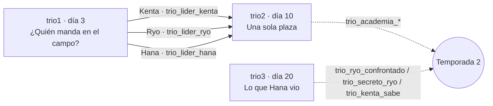

# Guía narrativa

Cómo diseñamos las tramas del modo historia sin que las ramas se salgan de control. Es un documento de trabajo **\[Propuesta\]** (2026-11-19). Lo que esté **[Aceptado]** en `docs/biblia.md` manda sobre esto.

## 1. Cómo funciona la historia en el juego

La historia no es un árbol. Es un conjunto de **escenas sueltas con condiciones**, lo que en las novelas de elección se llama *storylets* o narrativa basada en cualidades (Fallen London, King of Dragon Pass, Wildermyth).

- **Momento:** una escena con texto y de 1 a 3 opciones. Llega cuando se cumplen sus condiciones (día, temporada, rango, si el héroe está en tu gremio, marcas).
- **Marca:** lo que deja una decisión. Abre o cierra momentos posteriores. Es la única «memoria» de la historia.
- **Trama:** un grupo de personajes y sus momentos (el trío, la maestra, los dilemas, cada héroe con arco).
- **Epílogo:** el texto final de un héroe, según sus marcas o su destino.

Cada día, al terminar, el juego busca el primer momento pendiente que cumpla sus condiciones. Solo hay uno a la vez y cada uno ocurre una vez por partida. Motor: `src/motor/historia.ts`. Datos: `src/datos/historia.json`, que se genera desde el panel de tramas.

## 2. Reglas para no explotar

1. **Eco, no ramas.** Una decisión cambia cifras (lealtad, ánimo, oro) y deja una marca. Más adelante se nota con una línea o una opción distinta, no con una escena nueva para cada camino.
2. **Vigas y rombos.** Las ramas se abren y se vuelven a juntar en momentos fijos (las **vigas**), que ocurren pase lo que pase. Cada temporada termina en una viga.
3. **Huecos en vez de copias.** Una escena que cambia según quién la protagoniza se escribe una vez con un hueco (`{el_que_se_va}`). *Pendiente:* el motor aún no rellena huecos; hasta entonces, como mucho una variante por héroe del reparto, y solo en las vigas.
4. **Una ficha por trama**, de una página: premisa, reparto, variables, vigas y salidas.
5. **Las tramas solo se hablan por marcas públicas.** Una trama puede leer las marcas de *salida* de otra, nunca sus marcas internas. Las públicas se apuntan en la ficha.
6. **Presupuesto cerrado y comprobado** (`tests/revision-historia.test.ts`):
   - De 1 a 3 opciones por momento (mejor 2).
   - Escena de 90 palabras como máximo. Opción de 12 palabras como máximo.
   - Toda marca que se lee la pone alguna decisión (si no, ese momento nunca llegaría).
   - Cada héroe, personaje y trama citado existe.
   - Como guía: unas 4 vigas por trama y temporada.

El panel enseña también las marcas que se ponen y nadie lee: son contenido que sobra o un eco pendiente de escribir.

## 3. Ritmo: dilema semanal y escenas pequeñas

Decisión del propietario (2026-11-19):

- **Una gran decisión moral cada semana** (días 7, 14, 21, 28…), tipo **dilema**. En 5 temporadas son 20 dilemas escritos con cuidado.
- **Los demás días**, momentos y eventos pequeños de las tramas.

### Qué hace bueno un dilema

- Las dos opciones defienden algo legítimo. No hay una opción buena y otra mala.
- Cuesta algo que no se recupera (oro, lealtad, un héroe, prestigio).
- La consecuencia gorda llega más tarde, como eco.
- **No hay barra de karma** (sería un sistema nuevo y sermonea). Las marcas guardan qué valor priorizaste y los epílogos lo leen.

### Dilemas clásicos llevados al gremio

| Dilema | En el gremio | Estado |
|---|---|---|
| Heinz | La medicina de la hermana de Kenta: pagarla con la caja, negarla o mirar a otro lado. | Escrito (`dilema1`) |
| El tranvía | Abrir las compuertas salva un pueblo y arrasa la granja de la familia de Hana. | Escrito (`dilema2`) |
| El asesino a la puerta (Kant) | Una novata huida de las Sombras Negras se esconde en tu bodega. ¿Mientes al inspector? | Escrito (`dilema3`) |
| Dilema del prisionero | Pacto con la Corona Dorada para no pujar entre vosotros en la Prueba. | Escrito (`dilema4`) |
| Los que se alejan de Omelas | El gremio prospera mientras un héroe se destroza entrenando. | Idea |
| Antígona | Honrar a un caído contra la orden de la Asociación. | Idea |
| El anillo de Giges | Un objeto da poder y nadie lo sabría nunca. | Idea |
| Salomón | Dos héroes reclaman el mismo logro. | Idea |

## 4. Estados de una escena en el panel

| Estado | Entra en el juego | Para qué |
|---|---|---|
| Idea | No | Apuntes, ramas por decidir. Pueden estar incompletas. |
| Borrador | Sí, como provisional | Escrito y jugable, pendiente de revisar. |
| Listo | Sí | Revisado y aprobado por el propietario. |

## 5. Flujo de trabajo

1. El propietario o Claude escriben en el **panel de tramas**: un artefacto privado con base de datos compartida. El enlace no se guarda en el repositorio.
2. El panel dibuja cada trama como un grafo. Cada flecha va de una opción a la escena que su marca abre. Avisa de los problemas antes de subir.
3. **Subir al juego:** el propietario se lo pide a Claude en el chat («Sube el panel de tramas al juego»). Claude busca el panel en la lista de artefactos del propietario (título «Tramas del Gremio») y lee sus colecciones con la herramienta de datos del artefacto. Las junta en un JSON fuera del repositorio y ejecuta:

   ```bash
   npx tsx herramientas/panel.ts importar panel.json             # resumen y problemas
   npx tsx herramientas/panel.ts importar panel.json --escribir  # escribe heroes.json e historia.json
   npm run typecheck && npm test && npm run build
   ```

   Si hay problemas (un héroe con un rango que no existe, una escena sin opciones…), no se escribe nada. Al terminar, Claude actualiza el documento `meta/sync` del panel (fecha, commit y resumen) para que el contador «cambios sin subir» vuelva a «al día».
4. Para volver a sembrar el panel desde el repositorio: `npx tsx herramientas/panel.ts exportar panel.json`.

Desde el panel también se editan los héroes: nombre, clase, género, gremio, rangos, poder, rasgos, índices de romance y los textos de su habilidad. El **id de habilidad** solo lo cambia el código, porque cada habilidad está programada en `src/motor/habilidades.ts`. Un héroe nuevo llega con la habilidad «por diseñar».

## 6. Ficha: El trío

- **Premisa:** Kenta, Ryo y Hana empezaron juntos en el gremio. Sus celos y ambiciones obligan a favorecer a uno. Al final de la temporada 3, uno se marcha a un gremio rival.
- **Reparto:** Kenta (H81, Guerrero), Ryo (H82, Explorador), Hana (H83, Sanadora). Nombres y cifras provisionales.
- **Guía:** la antigua maestra Isolda (P01), que no lucha.
- **Variables:** lealtad y ánimo de cada uno. Marcas internas `trio_*`. *Propuesta pendiente (pregunta 26):* un registro oculto de atención calculado con lo que ya haces (misiones, entrenamiento, Ascensión, decisiones).
- **Salidas públicas:** `trio_lider_*` (a quién diste el mando) y, en la temporada 3, quién se va.

| Temporada | Viga | Qué pasa |
|---|---|---|
| 1 | Cimientos | Quién manda en el campo, la plaza de la Academia y el secreto de Ryo con el Dragón Carmesí. **Escrita.** |
| 2 | Grietas | Los celos se notan. El reparto de atención empieza a pesar. |
| 3 | Ruptura | Ultimátum. Al cerrar la temporada se va uno, según la atención y la decisión final. |
| 4 | Consecuencias | El que se fue compite en un rival. Los dos que quedan reaccionan. |
| 5 | Reencuentro | Cara a cara final con el antiguo compañero (como el némesis Solus). |



## 7. Ficha: La antigua maestra

- **Premisa:** Isolda dirigió el gremio treinta años. Una herida le impide salir de misión. Explica el juego y es la voz de la experiencia.
- **Reparto:** Isolda (P01, personaje sin ficha de héroe). Nombre provisional.
- **Escrito:** la bienvenida (día 1, `maestra_mentora` o `maestra_distante`) y la víspera de la primera Prueba (día 6).
- **Salidas públicas:** `maestra_mentora`. Más adelante puede cambiar su forma de hablar.

## 8. Ficha: Dilemas de la semana

- **Premisa:** cada fin de semana, una decisión moral sin respuesta correcta.
- **Escritos (temporada 1):** días 7, 14, 21 y 28 (tabla de la sección 3).
- **Salidas públicas:** `dilema_*` y `pacto_corona*`. Los ecos están por escribir. Por ejemplo, si traicionas el pacto, la Corona Dorada puja más fuerte contra ti.
